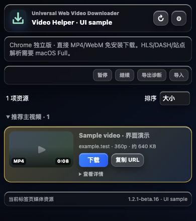

# DarrenVideoHelper

Detect video resources in the current tab and download direct MP4/WebM files in Chrome. The optional **macOS Full** edition keeps the beta.15 Native Messaging + yt-dlp + FFmpeg pipeline for HLS, DASH and supported site extractors.

[中文安装指南](README.zh-CN.md) · **v1.2.1-beta.16 — public prerelease**



*Actual popup UI rendered in Chrome with sample test data. This screenshot is a UI preview, not proof of a live extension download.*

## Download

- **[Chrome Extension ZIP — start here](https://github.com/savieri/DarrenVideoHelper/releases/download/v1.2.1-beta.16/DarrenVideoHelper-Chrome-Extension.zip)**: no Python, Homebrew, yt-dlp or Terminal for direct MP4/WebM downloads.
- **[macOS Full ZIP](https://github.com/savieri/DarrenVideoHelper/releases/download/v1.2.1-beta.16/DarrenVideoHelper-macOS-Full.zip)**: includes extension, Python host source and installer. **Requires locally installed Python 3.9+, yt-dlp, FFmpeg and ffprobe. These runtimes are not bundled.**
- [Release notes and checksums](https://github.com/savieri/DarrenVideoHelper/releases/tag/v1.2.1-beta.16)

## Install the Chrome extension

1. Download **DarrenVideoHelper-Chrome-Extension.zip** above.
2. Unzip it and keep the extracted folder in a permanent location.
3. Enter `chrome://extensions` in Chrome's address bar.
4. Turn on **Developer mode**.
5. Click **Load unpacked**.
6. Select the extracted folder that directly contains **manifest.json**.
7. Open a video webpage, play the target video for a few seconds, then click the extension icon. Select a direct MP4/WebM resource and click **下载** (Download).

Direct downloads use Chrome's default Downloads folder, inside **DarrenVideoHelper/**, and preserve the detected title and original `.mp4`/`.webm` format. Check `chrome://downloads` for Chrome's authoritative download status. Changing the Native Host output directory does not change Chrome's download folder.

Chrome requires these manual steps for an unpacked extension. This is not a Chrome Web Store install and cannot be installed by clicking a ZIP.

## Install macOS Full

1. Download and unzip **DarrenVideoHelper-macOS-Full.zip**.
2. Install the dependencies first. If you already use [Homebrew](https://brew.sh), run once:
   ```sh
   brew install python yt-dlp ffmpeg
   ```
   If you do not have Homebrew or want no Terminal setup, use the Chrome edition for direct files. **Full is not a zero-dependency package.**
3. Double-click **install.command**. It checks the dependencies, runs the host self-test and registers the Native Host for your user account. It does not install Homebrew, remove quarantine or modify Chrome security settings.
4. In `chrome://extensions`, enable Developer mode, click **Load unpacked** and select the included **extension/** folder.
5. Play a video and open the popup. Direct files use Chrome by default; HLS/DASH/site extraction uses the installed host. For a direct file needing captured request headers or MP4 conversion, enable **Full: direct MP4/WebM via Native Host** in Options and select/download the resource again. Retrying an old job keeps its original engine.

Keep the extension folder. The installer copies the host source into your Application Support folder. `uninstall.command` removes host registration and preserves downloads. When changing editions, remove the existing unpacked entry in Chrome, then load the new folder; both editions deliberately share one extension ID.

## Capabilities and compatibility

| Feature | Chrome edition | macOS Full |
| --- | --- | --- |
| Network + DOM + iframe detection | Included | Included |
| Current player binding; SPA navigation; resource list | Included | Included |
| HLS master and quality variants, duration and size evidence | Detection only | Detection + native download |
| Direct MP4 / WebM | Chrome download, original format | Chrome by default; optional native download |
| HLS → MP4 / separate DASH audio + video | Requires Full | Native pipeline, site dependent |
| YouTube / Bilibili page extraction | Requires Full | Existing pipeline retained; site dependent |
| Progress, completion, failure, queue, redacted diagnostics | Included | Included |
| Additional software | None for direct downloads | Python 3.9+, yt-dlp, FFmpeg/ffprobe |
| Operating systems | Validated here on macOS source/tests; Windows/Linux untested | Apple Silicon macOS checked; Intel macOS untested |

Chrome 119+ / Manifest V3 is required. **Windows and Linux are not claimed as tested or supported releases.** Legacy Windows build files remain in Git history/source for reference and are excluded from release packages.

## Limits

- HLS is detected in Chrome-only mode, but browser-side HLS-to-MP4 merging is **not shipped**. MSE is a playback API; simply saving a playlist or concatenating arbitrary segments does not guarantee a complete MP4. Large files, encrypted segments, split audio, discontinuities and expiring requests require a more robust pipeline. See [the design decision](docs/BROWSER_DOWNLOADS.md).
- Direct downloads do not transcode, add missing audio, or override server authentication, request-header, download or DRM restrictions. Some signed/CDN links can fail; use a fresh resource or Full when needed. A Chrome `complete` result confirms file transfer, not ffprobe validation.
- Resource sizes may be estimates; duration/quality can be unknown when the source provides no usable metadata. Ads/previews remain visible in their group and are not silently hidden.
- Full depends on tools installed on the user's Mac. New yt-dlp site requirements can change; no universal website guarantee is made.
- Native failed downloads can retain named resumable data for retry; completion requires native validation. No claim is made that every interrupted transfer leaves zero temporary data.
- Live extension loading, fresh-machine installation and real multi-site downloads were **not completed in this release session**. Chrome's internal extension page was blocked by the browser automation policy. See [validation evidence and remaining manual checks](VALIDATION.md).

## Troubleshooting

| Symptom | What to do |
| --- | --- |
| “Manifest file is missing” | Unzip first; choose the folder containing `manifest.json`, not the ZIP or its parent. |
| No media listed | Reload the webpage after first installation, play for 3–5 seconds, then refresh the popup. Restricted Chrome/internal pages are not video sources. |
| “需要 macOS Full” | The selected item is HLS/DASH or a site extractor. Install Full with its dependencies, or choose a direct MP4/WebM. |
| Native Host not found / forbidden | Run Full's installer; use Google Chrome and extension ID `mabnjnddplpelefjgohbjcoajnimpgna`. Other Chromium browsers are not registered. |
| Missing Python / yt-dlp / FFmpeg | Install dependencies, then rerun `install.command`. `install.command --check --non-interactive` checks without registering. |
| Installer blocked by macOS | Read the macOS notice and your security settings; use the Chrome edition if you do not want to run local scripts. This package is not notarized. |
| `SERVER_FORBIDDEN`, expired URL, or failed direct download | Play the video again, refresh the resource list and select its fresh URL. Check Chrome's Downloads page; servers may require Full or reject downloads. |
| Changed to another video | Reopen/refresh the popup and select the new resource. Stale sessions are rejected; do not reuse an old selection. |
| Download not in Native output folder | Direct Chrome downloads follow Chrome's download settings. |

## Privacy and permissions

No analytics or remote executable JavaScript is included. `<all_urls>`, tabs, scripting and webRequest enable media detection across pages and embedded frames. Downloads permission controls direct-file transfers. Only Full requests `nativeMessaging`. Request cookies may be used locally by Full when enabled; never upload them or local logs. Exported diagnostics redact credentials, titles, URL paths/queries and local user directories. Review any report before sharing it.

The manifest contains a **public key**, which keeps the extension ID stable. No signing private key is included. Our source is MIT; third-party tools retain their own licenses. The input FFmpeg executables are excluded from public packages because their dynamic libraries and corresponding build provenance were not supplied. [Third-party audit](THIRD_PARTY_NOTICES.md).

## Build and regression tests

For contributors with Node.js and Python 3.9+:

```sh
bash scripts/test.sh
```

This checks JS and shell syntax, runs the regression suite, builds both ZIPs, and validates manifests, references, the extension ID, executable modes, package contents and source parity. `python3 scripts/build_release.py` creates the two ZIPs and `dist/SHA256SUMS.txt`. No npm packages are needed. The Chrome package differs from `extension/` only in removing the `nativeMessaging` permission; JS/assets are identical. Full excludes all unreviewed runtime binaries.

Use GitHub's **Source code** downloads for the source at the release tag. The original beta.15 import and its SHA-256 inventory are retained in the repository history and [provenance inventory](docs/beta15-input-sha256.json).
