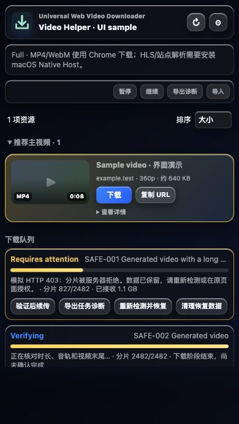

# DarrenVideoHelper

检测当前网页的视频资源，直接在 Chrome 下载 MP4/WebM。macOS Full 保留 beta.15 的 Native Messaging 下载链路：新增检查点 HLS + FFmpeg，保留固定版本 yt-dlp 处理站点解析等，处理 HLS、分离音视频和支持的站点解析。

[English](README.md) · **v1.2.1-beta.17，公开预发布版**



*截图展示真实界面代码配合示例数据的渲染结果，不代表已完成真实扩展加载及下载测试。*

## 下载与安装

**[Chrome 独立版 ZIP（普通用户优先下载）](https://github.com/savieri/DarrenVideoHelper/releases/download/v1.2.1-beta.17/DarrenVideoHelper-Chrome-Extension.zip)** · [macOS Full ZIP](https://github.com/savieri/DarrenVideoHelper/releases/download/v1.2.1-beta.17/DarrenVideoHelper-macOS-Full.zip) · [版本说明及校验值](https://github.com/savieri/DarrenVideoHelper/releases/tag/v1.2.1-beta.17)

Chrome 独立版下载直接 MP4/WebM 时，不需要 Python、Homebrew、yt-dlp 或 Terminal。

1. 下载 Chrome 独立版 ZIP。
2. 解压，保留解压后的文件夹。
3. 在 Chrome 地址栏输入 `chrome://extensions`。
4. 打开 **Developer mode / 开发者模式**。
5. 点击 **Load unpacked / 加载已解压的扩展程序**。
6. 选择**直接包含 manifest.json 的文件夹**。
7. 打开视频网页，播放几秒，点击插件图标，选择 MP4/WebM 资源并点击下载。

直接下载保存到 Chrome 默认下载目录下的 `DarrenVideoHelper/`，按检测到的名称命名，保留原始 MP4/WebM 格式。`chrome://downloads` 可查看真实下载状态。Native Host 的下载目录设置不会改变 Chrome 下载目录。

Chrome 安全机制要求手动加载；ZIP 不能点击后自动装入 Chrome。本项目尚未上架 Chrome Web Store。

## macOS Full 完整版

**Full 包含扩展、Host 源码和安装脚本。预先需要 Python 3.11+、FFmpeg 和 ffprobe；安装器会联网创建独立环境，安装哈希固定的 yt-dlp 2026.10.26，不修改全局 yt-dlp。发行包不捆绑这些运行环境。**

1. 下载 Full ZIP 并解压。
2. 如已有 [Homebrew](https://brew.sh)，在 Terminal 一次安装依赖：
   ```sh
   brew install python ffmpeg
   ```
   不希望配置环境时，先使用 Chrome 独立版下载直接文件。
3. 双击 `install.command`。脚本检查依赖、联网建立独立 yt-dlp 环境、运行自检，再为当前用户注册 Native Host；不会自动安装 Homebrew、移除隔离标记或更改 Chrome 安全设置。
4. 按上面的 Chrome 步骤加载 Full 包内的 **extension/** 文件夹。
5. 视频网页播放几秒后打开插件。MP4/WebM 默认用 Chrome 下载；HLS/DASH/站点解析调用本地 Host。直接文件需要特殊请求头或转 MP4 时，在设置勾选“Full：直接 MP4/WebM 使用 Native Host 下载”，然后重新选择资源下载；旧任务的重试保持原来的下载方式。

首次安装完成后，可运行 `install.command --check --non-interactive` 仅检查依赖，不下载环境或注册 Host。`uninstall.command` 仅移除注册，保留下载及已安装源码。两个版本共用同一个扩展 ID；切换版本时，在 Chrome 移除旧条目，再加载新文件夹。请保留扩展所在文件夹。

## 功能和系统范围

| 功能 | Chrome 独立版 | macOS Full |
| --- | --- | --- |
| 网络、DOM、iframe 多渠道检测 | 支持 | 支持 |
| 当前播放器绑定、SPA 跳转重新检测 | 保留 | 保留 |
| 所有资源、主视频推荐、广告/预览分组 | 保留 | 保留 |
| 时长、清晰度、大小及其依据 | 有证据时展示，可能未知/估算 | 同左 |
| 直接 MP4 / WebM | 原始文件下载 | 默认 Chrome；可选 Native |
| HLS 主清单、清晰度变体 | 识别和展示；下载需 Full | 本地下载并合并 |
| DASH 分离音视频、YouTube/Bilibili 解析 | 需要 Full | 保留原有链路；取决于站点和依赖 |
| 队列、进度、完成/失败、脱敏诊断 | 支持 | 支持 |
| 额外软件 | 直接下载无需 | Python 3.11+、FFmpeg/ffprobe；yt-dlp 由安装器建立独立环境 |

需要 Chrome 119+。本次验证环境为 Apple Silicon macOS；**Intel macOS、Windows、Linux 未实际完成测试，不宣称支持。** 完整版仅面向 Google Chrome on macOS。历史 Windows 脚本仍留在源码/历史中，不包含在发行 ZIP。

## beta.17 的 HLS 恢复

新增逐分片检查点、SHA-256 收据、有限 HTTP 重试、跨重启保留 Retry-After、清单/视频身份验证、独立重试合并和验证后原子发布。支持完整 VOD 的 TS、fMP4/MAP、字节范围、正常授权 AES-128 和默认独立音轨。其他音轨与字幕不导出。

恢复前核对序列、时长、清晰度、格式和加密信息，校验全部本地分片并复核远端样本；不兼容时停止。进度 100% 后仍需合并及校验，不能视作完成。旧 .part 没有兼容检查点时不会冒称可续传；旧数据不会因升级被自动删除。

需要操作时，回原视频页面正常播放/授权，再点“重新检测并恢复”。只有保留了可验证数据才显示“验证后续传”。取消时可选择保留恢复数据；“清理恢复数据”只清理本任务。服务器持续拒绝时会停止，不保证 403 都能恢复。

**100 项回归通过**，另完成真实 Native 进程被杀后的续传及 2482 分片、2.2 GiB 生成视频压力测试。[完整修复报告](docs/REPAIR_REPORT_beta17.md) · [测试范围](VALIDATION.md)。尚未宣称目标网站已修复。

## 已知限制

- Chrome 独立版**没有实现浏览器端 HLS 转 MP4**。不会把 m3u8 清单伪装成视频。MSE 主要服务播放，简单拼接分片不能保证完整 MP4；大型视频、加密分片、分离音频、时间戳跳变和过期链接等仍交给 Full。[技术说明](docs/BROWSER_DOWNLOADS.md)
- 直接下载保留原始格式，不转码、不补音轨、不保证所有带鉴权/特殊请求头的 CDN 都可下载。Chrome 的 Completed 表示传输完成，不代表经 ffprobe 验证。
- 不处理 DRM，也不绕过付费或访问控制。站点更新可能使 yt-dlp 解析失效。
- 可恢复的 Native HLS 任务保留独立隐藏目录中的已校验分片；成功后清理分片/密钥并保留检查点。动态/Live、低延迟/增量清单和不兼容时间戳会明确失败并保留输入；不能承诺所有中断场景完全不留下临时数据。
- 本轮没有完成真实扩展加载、全新电脑安装和多站点实下载：自动化浏览器禁止访问 Chrome 内部扩展管理页。已完成与未完成测试详见 [VALIDATION.md](VALIDATION.md)。

## 常见问题

| 问题 | 处理 |
| --- | --- |
| 找不到 manifest.json | 先解压，再选择直接含该文件的文件夹。 |
| 检测不到资源 | 首次装好后刷新视频网页，播放 3–5 秒，再刷新插件。Chrome 内部页面不支持检测。 |
| 显示“需要 macOS Full” | 当前资源是 HLS/DASH/站点解析；安装 Full 及依赖，或选择直接 MP4/WebM。 |
| Native Host not found / forbidden | 重跑安装脚本，确认使用 Google Chrome，扩展 ID 为 `mabnjnddplpelefjgohbjcoajnimpgna`。 |
| 缺少 Python/yt-dlp/FFmpeg | 安装依赖后重新双击 install.command。 |
| macOS 阻止脚本打开 | 查看系统提示和安全设置；不希望运行脚本可用 Chrome 独立版。本包未公证签名。 |
| 403 / 链接过期 / SERVER_FORBIDDEN | 重新播放并刷新资源；检查 Chrome 下载记录。部分来源需要 Full 或不允许直接下载。 |
| 切换了视频 | 刷新插件，重新选择新资源；旧 session 的选择会被拒绝。 |
| 下载目录不对 | 直接下载跟随 Chrome 默认目录，Host 目录只影响本地下载链路。 |

## 隐私、许可与开发

没有遥测和远程可执行 JS。网页/iframe 检测需要 `<all_urls>`、tabs、scripting、webRequest；直接下载使用 downloads 权限。只有 Full 请求 nativeMessaging。Host 可按设置使用本地 Cookie；不要公开 Cookie、日志或用户下载内容。导出诊断会移除凭据、标题、URL 路径/查询及本地用户路径，分享前仍请自行复核。

manifest 中是保持固定 ID 的**公钥**，不包含签名私钥。项目源码采用 MIT；第三方工具保留其自身许可。本次没有重新分发原包中仅适用于开发机的 FFmpeg 二进制。[第三方检查记录](THIRD_PARTY_NOTICES.md)

开发者安装 Node.js、Python 3.11+ 后执行 `bash scripts/test.sh`，可运行回归测试、打包和结构检查。直接运行 `python3 scripts/build_release.py` 会生成两个 ZIP 和 SHA256SUMS。JS 和资源在两个版本之间一致；Chrome 包仅移除 nativeMessaging 权限。GitHub 自动 Source code 对应发布 Tag，beta.15 的导入和校验清单保留在 Git 历史中。

默认只为已识别的媒体保留请求 Cookie。读取本机 Chrome Cookie 数据库是独立的可选功能，新安装默认关闭；已有保存偏好不变。没有扩展名、首次仅通过响应识别的媒体，可能需要播放器再次请求后才能捕获媒体授权。
